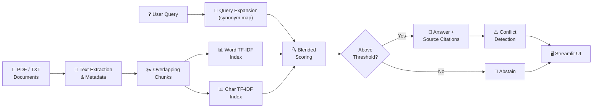

<div align="center">


</div>

<div align="center">


<br/>

### A lightweight, offline RAG system that answers questions from college documents
### with source citations — no paid LLM API needed. 🎓

<br/>

**[✨ Features](#-features) · [🏗️ Architecture](#%EF%B8%8F-architecture) · [🚀 Quick Start](#-quick-start) · [🔬 How It Works](#-how-it-works) · [🧪 Testing](#-testing) · [🔧 Examples](#-examples)**

</div>

---

## ✨ Features

| | Feature | Description |
|---|---|---|
| 📄 | **Multi-format ingestion** | Parse PDFs (PyMuPDF) and TXT files with full page metadata |
| 🔍 | **Dual TF-IDF retrieval** | Blended word + character n-gram scoring for robust matching |
| 🧠 | **Query expansion** | Built-in synonym map for college terminology improves recall |
| ⚖️ | **Conflict detection** | Flags contradictory information across documents automatically |
| 🚫 | **Abstention** | Declines to answer when no relevant passage is found |
| 📎 | **Source citations** | Every answer includes filename and page number |
| 🖥️ | **Streamlit web UI** | Clean, interactive interface for uploading and querying |
| 🧪 | **14 automated tests** | pytest suite covering edge cases, paraphrasing, multi-doc synthesis |
| 🔒 | **Fully offline** | Zero API costs — runs entirely on your machine |

---

## 🏗️ Architecture



<div align="center">

**Scoring Formula:** `Score = 0.60 × word_tfidf + 0.20 × char_tfidf + 0.15 × exact_overlap + 0.05 × expanded_overlap`

| Signal | Weight | Purpose |
|--------|--------|---------|
| Word TF-IDF cosine similarity | **60%** | Primary semantic match |
| Char TF-IDF cosine similarity | **20%** | Handles typos & morphological variants |
| Exact token overlap | **15%** | Rewards direct keyword hits |
| Expanded token overlap | **5%** | Covers synonym-expanded terms |

</div>

---

## 📂 Project Structure

```
RAG/
│
├── 🖥️  src/
│   ├── app.py                        # Streamlit web application
│   └── rag_pipeline.py               # Core RAG engine — CollegeRAG class
│
├── 🧪  tests/
│   ├── test_rag.py                   # 14 automated pytest test cases
│   └── test_questions.json           # Test question bank + expected answers
│
├── 📄  data/
│   └── sample_documents/             # 6 sample college policy docs (PDF/TXT)
│
├── 📓  notebooks/
│   ├── attention_is_all_you_need_rag.ipynb
│   └── rag_tutorial.ipynb
│
├── 🔧  examples/
│   ├── langchain_rag_app.py          # LangChain + FAISS + Ollama variant
│   ├── rag_chatbot_with_llm.py       # LLM-powered chatbot
│   ├── chatbot_demo.py               # Minimal chatbot demo
│   ├── streamlit_tutorial.py         # Streamlit basics walkthrough
│   └── cnn_image_classifier.py       # Bonus: CNN image classifier
│
├── 📖  docs/problem_statement.md
├── requirements.txt
├── .gitignore
├── LICENSE
└── README.md
```

---

## 🚀 Quick Start

**1. Clone & enter the repo**
```bash
git clone https://github.com/Soham-Sahana/RAG.git
cd RAG
```

**2. Create a virtual environment**
```bash
# Windows
python -m venv venv
venv\Scripts\activate

# Linux / macOS
python -m venv venv
source venv/bin/activate
```

**3. Install dependencies**
```bash
pip install -r requirements.txt
```

**4. Add your documents**

Drop your college PDF or TXT files into `data/sample_documents/`.

**5. Launch the app**
```bash
streamlit run src/app.py
```

Opens at **http://localhost:8501** 🚀

**6. Run tests**
```bash
pytest tests/test_rag.py -v
```

---

## ⚙️ Tech Stack

<div align="center">

| Category | Technology |
|----------|-----------|
| **Language** | Python 3.10+ |
| **Web UI** | Streamlit |
| **Retrieval Engine** | scikit-learn · TF-IDF · Cosine Similarity |
| **PDF Parsing** | PyMuPDF |
| **Numerical Computing** | NumPy |
| **Testing** | pytest |
| **LLM / API Required?** | ❌ None — fully extractive & offline |

</div>

---

## 🔬 How It Works

### 1 · Document Ingestion
PyMuPDF reads PDFs page-by-page; text files are read with encoding fallback. Every chunk is tagged with its **source filename** and **page number** for citation.

### 2 · Chunking
Text is split into overlapping windows (`chunk_size=900`, `overlap=150` by default). Overlap ensures content near chunk boundaries is never lost.

### 3 · Dual TF-IDF Index
Two vectorizers run in parallel:
- **Word n-grams (1–2)** — Classic term-frequency for word-level matching
- **Char n-grams (3–5)** — Sub-word patterns for typo tolerance and morphological variants

### 4 · Query Expansion
A hand-tuned synonym map expands queries before scoring. `"library hours"` → also searches `"opening closing timing schedule"`.

### 5 · Blended Scoring & Abstention
Four signals are weighted and summed. If the top score stays below the confidence threshold, the system **abstains** rather than returning a low-confidence answer.

### 6 · Conflict Detection
If library-hours queries hit passages from multiple documents with *different* time values, a conflict is flagged and both sources are shown.

---

## 🧪 Testing

Run all 14 tests:
```bash
pytest tests/test_rag.py -v
```

<div align="center">

| Test Scenario | Coverage |
|---|---|
| Direct single-document answer | ✅ |
| Multi-document information synthesis | ✅ |
| Unanswerable question abstention | ✅ |
| Paraphrased question handling | ✅ |
| Conflicting document detection | ✅ |
| Library policy queries (fine, limit, duration) | ✅ |
| Examination requirement queries | ✅ |
| Scholarship document queries | ✅ |
| Source metadata preservation | ✅ |
| Blank / empty query edge case | ✅ |

</div>

---

## 🔧 Examples

| File | Description |
|------|-------------|
| [`langchain_rag_app.py`](examples/langchain_rag_app.py) | LangChain + FAISS + Ollama — LLM-powered answers |
| [`rag_chatbot_with_llm.py`](examples/rag_chatbot_with_llm.py) | Full chatbot feeding retrieved passages into an LLM |
| [`chatbot_demo.py`](examples/chatbot_demo.py) | Minimal chatbot skeleton for quick prototyping |
| [`streamlit_tutorial.py`](examples/streamlit_tutorial.py) | Streamlit basics walkthrough |
| [`cnn_image_classifier.py`](examples/cnn_image_classifier.py) | Bonus: CNN image classifier (CIFAR-10 / custom dataset) |

---

## 📖 Key Concepts Covered

- **Retrieval-Augmented Generation (RAG)** — Grounding answers in real source documents
- **TF-IDF Vectorization** — Classical IR with word and character n-grams
- **Cosine Similarity** — Measuring query-document closeness
- **Query Expansion** — Synonym-based recall improvement without hallucination
- **Conflict Detection** — Identifying contradictions across multiple sources
- **Extractive QA** — Returning verbatim passages, not generated text
- **Document Chunking** — Sliding-window splitting with configurable overlap

---

## ⚠️ Limitations

- **Lexical only** — TF-IDF cannot capture semantic similarity between different phrasings
- **No generative answers** — Passages are returned verbatim, not synthesised
- **Static synonym map** — Needs manual updates for new terminology
- **Scale ceiling** — Best suited for hundreds to a few thousand document chunks

> 💡 For semantic retrieval, see [`examples/langchain_rag_app.py`](examples/langchain_rag_app.py) which uses dense HuggingFace embeddings + FAISS.

---

## 🤝 Contributing

Contributions, issues, and feature requests are welcome!
Feel free to open an [issue](https://github.com/Soham-Sahana/RAG/issues) or submit a pull request.

---

## 📬 Contact

**Soham Sahana** — [GitHub](https://github.com/Soham-Sahana)

---

<div align="center">


</div>
