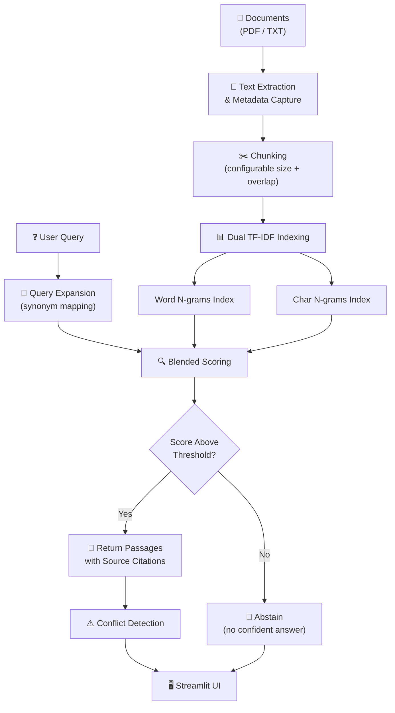

# 🎓 College Knowledge Assistant

**A lightweight, offline RAG pipeline that retrieves precise answers from college documents — no LLM API required.**


---

## Overview

College Knowledge Assistant is a Python-based Retrieval-Augmented Generation (RAG) system purpose-built for answering questions about college policies, procedures, and documents. Unlike typical RAG systems that depend on expensive cloud-hosted LLMs, this project uses **extractive retrieval** — it finds and returns the most relevant passages directly from your documents, complete with source citations.

Upload your college PDFs and text files, ask a question in plain English, and get back highlighted answers with page numbers and filenames. The entire pipeline runs locally on your machine with zero API costs.

---

## Features

- 📄 **Multi-format document ingestion** — Parse PDFs (via PyMuPDF) and plain text files with full metadata preservation
- 🔍 **Dual TF-IDF retrieval** — Blended word n-gram and character n-gram scoring for robust passage matching
- 🧠 **Query expansion** — Built-in synonym mapping for common college terminology improves recall
- ⚖️ **Conflict detection** — Automatically flags contradictory information across documents (e.g., differing library hours)
- 🚫 **Abstention** — Gracefully declines to answer when no relevant passage is found, avoiding hallucination
- 📎 **Source citations** — Every answer includes the originating filename and page number
- 🖥️ **Streamlit web UI** — Clean, interactive interface for uploading documents and querying
- 🧪 **14 automated tests** — Comprehensive pytest suite covering edge cases, paraphrasing, and multi-document synthesis
- 🔒 **Fully offline** — No internet connection or paid API keys needed after installation

---

## Architecture



**Scoring breakdown:**

| Component | Weight | Description |
|---|---|---|
| Word TF-IDF cosine similarity | 60% | Primary semantic match on word-level n-grams |
| Char TF-IDF cosine similarity | 20% | Captures partial word matches and morphological variants |
| Exact token overlap | 15% | Rewards direct keyword hits between query and passage |
| Expanded token overlap | 5% | Accounts for synonym-expanded query terms |

---

## Quick Start

### Prerequisites

- Python 3.10 or higher
- pip (Python package manager)

### Installation

**1. Clone the repository**

```bash
git clone https://github.com/Soham-Sahana/RAG.git
cd RAG
```

**2. Create and activate a virtual environment**

```bash
# Linux / macOS
python -m venv venv
source venv/bin/activate

# Windows
python -m venv venv
venv\Scripts\activate
```

**3. Install dependencies**

```bash
pip install -r requirements.txt
```

**4. Add your documents**

Place your college PDF and TXT files into the `data/sample_documents/` directory.

**5. Launch the app**

```bash
streamlit run src/app.py
```

The Streamlit interface will open in your default browser at `http://localhost:8501`.

---

## Project Structure

```
├── src/
│   ├── app.py                  # Streamlit web application
│   └── rag_pipeline.py         # Core RAG engine (CollegeRAG class)
├── tests/
│   ├── test_rag.py             # 14 automated test cases
│   └── test_questions.json     # Test question bank with expected answers
├── data/
│   └── sample_documents/       # Sample college policy documents
├── notebooks/
│   ├── attention_is_all_you_need_rag.ipynb
│   └── rag_tutorial.ipynb
├── examples/
│   ├── langchain_rag_app.py    # LangChain + FAISS + Ollama variant
│   ├── rag_chatbot_with_llm.py # LLM-powered chatbot variant
│   ├── chatbot_demo.py         # Simple chatbot demo
│   ├── streamlit_tutorial.py   # Streamlit basics tutorial
│   ├── cnn_image_classifier.py # CNN classifier (bonus)
│   └── cnn_model.py            # CNN model architecture
├── docs/
│   └── problem_statement.md    # Original project requirements
├── requirements.txt
├── .gitignore
├── LICENSE
└── README.md
```

---

## How It Works

The retrieval pipeline is implemented in `src/rag_pipeline.py` through the `CollegeRAG` class. Here is a step-by-step walkthrough of what happens when you ask a question:

### 1. Document Ingestion

Documents are read from disk using PyMuPDF for PDFs and standard file I/O for text files. Each page or logical section is tagged with source metadata — the originating filename and page number — so that every answer can be traced back to its source.

### 2. Chunking

Extracted text is split into overlapping chunks with configurable `chunk_size` and `overlap` parameters. Overlapping ensures that sentences near chunk boundaries are not lost, which is critical for questions whose answers span two adjacent sections.

### 3. Dual TF-IDF Index Construction

Two separate TF-IDF vectorizers are built over the chunk corpus:

- **Word n-grams** — Captures standard term-frequency signals at the word level.
- **Character n-grams** — Captures sub-word patterns, making the system more resilient to typos, abbreviations, and morphological variations (e.g., matching "library" against "libraries").

### 4. Query Expansion

Before scoring, the user's query is expanded using a synonym map tailored to common college terminology. For example, a query about "fees" might expand to include "charges," "costs," and "tuition," improving recall without sacrificing precision.

### 5. Blended Scoring

Each chunk is scored against the (expanded) query using four signals, combined as a weighted sum:

$$S = 0.60 \cdot \text{word\_tfidf} + 0.20 \cdot \text{char\_tfidf} + 0.15 \cdot \text{exact\_overlap} + 0.05 \cdot \text{expanded\_overlap}$$

Chunks are ranked by this composite score. If the top score falls below a confidence threshold, the system abstains rather than returning a low-quality answer.

### 6. Conflict Detection

When the top-ranked passages originate from different source documents and contain contradictory information (e.g., two documents listing different library hours), the system flags the conflict and presents both sources to the user.

---

## Testing

Run the full test suite with:

```bash
pytest tests/test_rag.py -v
```

The 14 test cases validate the following scenarios:

| Category | What is tested |
|---|---|
| **Single-document answers** | Correct passage retrieval from a single source |
| **Multi-document synthesis** | Combining information across multiple documents |
| **Unanswerable questions** | Proper abstention when no relevant passage exists |
| **Paraphrased queries** | Handling semantically equivalent but differently worded questions |
| **Conflict detection** | Flagging contradictory information across sources |
| **Library policies** | Fines, borrowing limits, and loan duration queries |
| **Examination rules** | Retrieving exam requirements and policies |
| **Scholarship queries** | Finding scholarship eligibility and deadline information |
| **Source metadata** | Verifying that filenames and page numbers are preserved |
| **Edge cases** | Handling blank or empty queries gracefully |

Test questions and expected answers are defined in `tests/test_questions.json`, making it easy to extend the suite.

---

## Examples

The `examples/` directory contains alternative implementations and demos for learning and experimentation:

- **`langchain_rag_app.py`** — A variant using LangChain, FAISS vector store, and Ollama for local LLM-powered answers.
- **`rag_chatbot_with_llm.py`** — A conversational chatbot that feeds retrieved passages into an LLM for generated (abstractive) answers.
- **`chatbot_demo.py`** — A minimal chatbot skeleton for quick prototyping.
- **`streamlit_tutorial.py`** — A step-by-step Streamlit tutorial for newcomers to the framework.
- **`cnn_image_classifier.py` / `cnn_model.py`** — Bonus: a CNN-based image classifier demonstrating a different ML pipeline.

---

## Limitations

This project intentionally uses TF-IDF for retrieval rather than dense semantic embeddings. This comes with trade-offs worth understanding:

- **Lexical matching only** — TF-IDF relies on surface-level word overlap. Semantically similar but lexically different queries (e.g., "tuition waiver" vs. "fee exemption") may miss relevant passages unless covered by the synonym map.
- **No generative answers** — The system returns extracted passages verbatim. It does not synthesize or rephrase answers in natural language.
- **Static synonym map** — Query expansion depends on a hand-curated synonym dictionary. Unseen terminology requires manual updates.
- **No cross-encoder reranking** — Passages are ranked by a single-stage retrieval score. Adding a cross-encoder reranker could improve precision.
- **Scale ceiling** — TF-IDF with scikit-learn works well for hundreds to low thousands of documents. For larger corpora, consider migrating to FAISS or a dedicated vector database.

> For production deployments requiring deeper semantic understanding, consider the LangChain + embedding model variant in `examples/langchain_rag_app.py`.

---

## Contributing

Contributions are welcome! Here is how to get started:

1. **Fork** the repository
2. **Create a feature branch** — `git checkout -b feature/your-feature-name`
3. **Write tests** for any new functionality in `tests/test_rag.py`
4. **Run the test suite** — `pytest tests/test_rag.py -v` (all tests must pass)
5. **Submit a pull request** with a clear description of your changes

Please keep pull requests focused on a single change and follow the existing code style.

---

## License

This project is licensed under the **MIT License**. See the [LICENSE](LICENSE) file for details.

---

*Built with curiosity and Python — no cloud LLM budget required.* ✨
