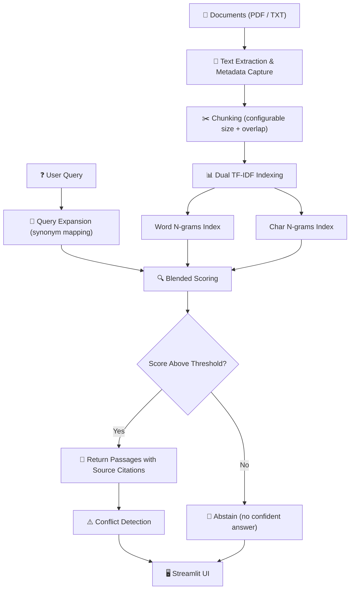

<div align="center">


<br/>


<br/>

A lightweight, offline **Retrieval-Augmented Generation** pipeline that retrieves precise answers from college documents with source citations — **no paid LLM API required**.

---

[Features](#-features) · [Architecture](#-architecture) · [Getting Started](#-getting-started) · [How It Works](#-how-it-works) · [Testing](#-testing) · [Examples](#-examples)

</div>

<br/>

## ✨ Features

- 📄 **Multi-format document ingestion** — Parse PDFs (via PyMuPDF) and plain text files with full metadata preservation
- 🔍 **Dual TF-IDF retrieval** — Blended word n-gram and character n-gram scoring for robust passage matching
- 🧠 **Query expansion** — Built-in synonym mapping for common college terminology improves recall
- ⚖️ **Conflict detection** — Automatically flags contradictory information across documents (e.g., differing library hours)
- 🚫 **Abstention** — Gracefully declines to answer when no relevant passage is found, avoiding hallucination
- 📎 **Source citations** — Every answer includes the originating filename and page number
- 🖥️ **Streamlit web UI** — Clean, interactive interface for uploading documents and querying
- 🧪 **14 automated tests** — Comprehensive pytest suite covering edge cases, paraphrasing, and multi-document synthesis
- 🔒 **Fully offline** — No internet connection or paid API keys needed after installation

---

## 🏗️ Architecture



<div align="center">

| Component | Weight | Description |
|-----------|--------|-------------|
| Word TF-IDF cosine similarity | 60% | Primary semantic match on word-level n-grams |
| Char TF-IDF cosine similarity | 20% | Captures partial word matches and morphological variants |
| Exact token overlap | 15% | Rewards direct keyword hits between query and passage |
| Expanded token overlap | 5% | Accounts for synonym-expanded query terms |

</div>

---

## 📂 Project Structure

```
College-Knowledge-Assistant/
│
├── 🖥️ Source
│   ├── src/app.py                  # Streamlit web application
│   └── src/rag_pipeline.py         # Core RAG engine (CollegeRAG class)
│
├── 🧪 Tests
│   ├── tests/test_rag.py           # 14 automated test cases
│   └── tests/test_questions.json   # Test question bank with expected answers
│
├── 📄 Data
│   └── data/sample_documents/      # Sample college policy documents (6 files)
│
├── 📓 Notebooks
│   ├── notebooks/attention_is_all_you_need_rag.ipynb
│   └── notebooks/rag_tutorial.ipynb
│
├── 🔧 Examples
│   ├── examples/langchain_rag_app.py      # LangChain + FAISS + Ollama variant
│   ├── examples/rag_chatbot_with_llm.py   # LLM-powered chatbot variant
│   ├── examples/chatbot_demo.py           # Simple chatbot demo
│   ├── examples/streamlit_tutorial.py     # Streamlit basics tutorial
│   ├── examples/cnn_image_classifier.py   # CNN classifier (bonus)
│   └── examples/cnn_model.py             # CNN model architecture
│
├── 📖 Docs
│   └── docs/problem_statement.md          # Original project requirements
│
├── requirements.txt
├── .gitignore
├── LICENSE
├── CONTRIBUTING.md
└── README.md
```

---

## 🚀 Getting Started

### Prerequisites

```bash
pip install streamlit PyMuPDF scikit-learn numpy pytest
```

Or install from requirements:

```bash
python -m venv venv
source venv/bin/activate       # Linux / macOS
venv\Scripts\activate          # Windows
pip install -r requirements.txt
```

### Run the App

```bash
streamlit run src/app.py
```

The Streamlit interface will open in your browser at `http://localhost:8501`.

### Run Tests

```bash
pytest tests/test_rag.py -v
```

---

## ⚙️ Tech Stack

<div align="center">

| Category | Technologies |
|----------|-------------|
| **Language** | Python 3.10+ |
| **Web UI** | Streamlit |
| **Retrieval** | scikit-learn (TF-IDF + Cosine Similarity) |
| **PDF Parsing** | PyMuPDF |
| **Data** | NumPy |
| **Testing** | pytest |
| **LLM Required?** | ❌ No — fully extractive retrieval |

</div>

---

## 🔬 How It Works

### 1. Document Ingestion
Documents are read from disk using PyMuPDF for PDFs and standard file I/O for text files. Each page is tagged with source metadata — filename and page number — so every answer traces back to its source.

### 2. Chunking
Extracted text is split into overlapping chunks with configurable `chunk_size` and `overlap`. Overlapping ensures sentences near chunk boundaries are not lost.

### 3. Dual TF-IDF Index
Two separate TF-IDF vectorizers are built:
- **Word n-grams** — Standard term-frequency signals at the word level
- **Character n-grams** — Sub-word patterns for resilience to typos and morphological variations

### 4. Query Expansion
Queries are expanded using a synonym map tailored to college terminology. A query about "library hours" automatically includes "opening," "closing," "timing," and "schedule."

### 5. Blended Scoring
Each chunk is scored using four signals combined as a weighted sum:

```
Score = 0.60 × word_tfidf + 0.20 × char_tfidf + 0.15 × exact_overlap + 0.05 × expanded_overlap
```

### 6. Conflict Detection
When top passages from different documents contain contradictory information (e.g., different library hours), the system flags the conflict and presents both sources.

---

## 🧪 Testing

<div align="center">

| Category | What is tested |
|----------|---------------|
| **Single-document answers** | Correct passage retrieval from a single source |
| **Multi-document synthesis** | Combining information across multiple documents |
| **Unanswerable questions** | Proper abstention when no relevant passage exists |
| **Paraphrased queries** | Handling semantically equivalent but differently worded questions |
| **Conflict detection** | Flagging contradictory information across sources |
| **Library policies** | Fines, borrowing limits, and loan duration queries |
| **Examination rules** | Retrieving exam requirements and policies |
| **Scholarship queries** | Finding scholarship eligibility and deadline information |
| **Source metadata** | Verifying that filenames and page numbers are preserved |
| **Edge cases** | Handling blank or empty queries gracefully |

</div>

---

## 🔧 Examples

| Example | Description |
|---------|-------------|
| [**LangChain RAG App**](examples/langchain_rag_app.py) | Variant using LangChain, FAISS vector store, and Ollama for local LLM-powered answers |
| [**RAG Chatbot with LLM**](examples/rag_chatbot_with_llm.py) | Conversational chatbot that feeds retrieved passages into an LLM for abstractive answers |
| [**Chatbot Demo**](examples/chatbot_demo.py) | Minimal chatbot skeleton for quick prototyping |
| [**Streamlit Tutorial**](examples/streamlit_tutorial.py) | Step-by-step Streamlit tutorial for framework newcomers |
| [**CNN Image Classifier**](examples/cnn_image_classifier.py) | Bonus: CNN-based image classifier demonstrating a different ML pipeline |

---

## 📖 Key Concepts Covered

- **Retrieval-Augmented Generation (RAG)** — Grounding answers in source documents
- **TF-IDF Vectorization** — Classical information retrieval with word and character n-grams
- **Cosine Similarity** — Measuring semantic closeness between query and document chunks
- **Query Expansion** — Synonym-based recall improvement
- **Conflict Detection** — Identifying contradictory information across multiple sources
- **Extractive QA** — Returning verbatim passages instead of generated text
- **Document Chunking** — Splitting documents with configurable overlap for boundary coverage

---

## ⚠️ Limitations

- **Lexical matching only** — TF-IDF relies on surface-level word overlap; semantically similar but lexically different queries may miss passages
- **No generative answers** — Returns extracted passages verbatim without synthesis
- **Static synonym map** — Query expansion depends on a hand-curated dictionary
- **No cross-encoder reranking** — Single-stage retrieval scoring only
- **Scale ceiling** — Works well for hundreds to low thousands of documents

> 💡 For deeper semantic understanding, see the LangChain + embedding model variant in [`examples/langchain_rag_app.py`](examples/langchain_rag_app.py)

---

## 🤝 Contributing

Contributions, issues, and feature requests are welcome! Feel free to open an issue or submit a pull request.

---

## 📬 Contact

**Soham Sahana** — [GitHub](https://github.com/Soham-Sahana)

---

<div align="center">


</div>
